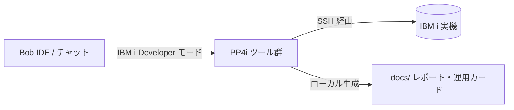

# 00-準備: PP4i 接続確認と Bob の設定 🔌

## 🎯 この準備の目標

ハンズオンを始める前に、**Code for IBM i による IBM i 実機への接続** と **Bob のモード（IBM i Developer）設定** を行い、Bob が PP4i ツール経由で IBM i の SQL や CL コマンドを実行できることを確認します。

**所要時間**: 5分
**使用モード**: IBM i Developer モード
**ワークスペース**: Local（作業フォルダ：`3_ibmi-hands-on-Operations`）

---

## ステップ1: ハンズオンフォルダーを開く（1分）

1. Bob IDE を起動します。
2. メニューの **「ファイル」→「フォルダーを開く...」**（macOS: **「File」→「Open Folder...」**）から、`3_ibmi-hands-on-Operations` フォルダーを選択して開きます。

   > ⚠️ **リポジトリのルート（`ibmi-bob-jp`）ではなく、必ず `3_ibmi-hands-on-Operations` フォルダーそのものを開いてください。** ルートを開くと開発編のルールが読み込まれ、運用編の安全ルール（`ops-safety.md`）が適用されません。

3. エクスプローラーに `LAB1-OPS.md` や `.bob/rules/ops-safety.md` 等が表示されていることを確認します。

> 💡 **`.bob/rules/ops-safety.md` について**:
> このフォルダーを開くと、Bob は安全運用ルールを自動的に読み込みます。「参照系は自由・更新系は事前提示と承認必須・システム停止などの危険コマンドは禁止」というガードレールが常時有効になります。

---

## ステップ2: Code for IBM i で実機に接続する（2分）

1. VS Code / Bob IDE のアクティビティバー（左端のアイコン群）から **IBM i サーバーアイコン** をクリックします。
2. 接続設定（または既存の接続設定の鉛筆アイコン）を開き、講師から指定された情報を設定します。

| 項目 | 入力値（例） | 説明 |
|---|---|---|
| **Connection Name** | `IBMI-HANDSON` | 任意の接続名 |
| **Host or IP Address** | 講師から指定 | IBM i サーバーの IP またはホスト名 |
| **Port** | `22` | SSH ポート番号 |
| **Username** | `STUDYxx`（例：`STUDY01`） | 配布された参加者ユーザープロファイル |
| **Password** | 講師から指定 | パスワード |

3. **「Connect」** をクリックし、接続に成功するとステータスバーや IBM i ビューに「Connected」と表示されます。
4. **ライブラリー・リストの確認**:
   - Code for IBM i ビューの「User Library List」に、自分の作業ライブラリー `STUDYxx`（例：`STUDY01`）および共通ライブラリー `HANDSON` が追加されていることを確認します。（追加されていない場合は右クリックからライブラリーを追加してください）

---

## ステップ3: Bob のモードとワークスペースを設定する（1分）

1. チャット入力欄を開き、上部の **New Task**（新しいタスク）をクリックします。
2. ワークスペースとして **「Local」** を選択します。
3. チャットウィンドウ左下のモード選択から **「IBM i Developer」** を選択します。



> 💡 **なぜ Local ワークスペースで IBM i Developer モード？**
> 運用編では、実機 IBM i に対して SQL（`execute_sql_statement`）や CL（`execute_cl_command`）、メンバー読み込み（`read_member`）を実行しつつ、生成された稼働レポートや運用ドキュメントをローカルの `docs/` フォルダーに保存します。Local ワークスペースでも PP4i の全接続ツールがシームレスに動作します。

---

## ステップ4: 実機への疎通確認（1分）

以下のプロンプトをチャット欄に入力し、Bob に実機情報の取得を依頼します：

```
接続中の IBM i 実機について、以下を SQL で調べて表形式で教えてください。
- システム名
- OS のバージョン・リリース
- 現在のユーザー名
- 現在時刻（CURRENT TIMESTAMP）
```

**期待される動作**:
1. Bob が `execute_sql_statement` ツールを使用し、IBM i の環境情報テーブル（`SYSIBMADM.ENV_SYS_INFO` 等）から情報を取得する SQL を実行します。
2. 実行結果がチャット上に表形式で表示されます。

> ✅ **確認**:
> 接続先のシステム名や自分のユーザー名（例：`STUDY01`）が表示されれば、実機接続と PP4i ツールの連携は成功です！

> ⚠️ **トラブルシューティング**:
> - **「IBM i に接続されていません」と表示される場合**: Code for IBM i の接続状態が切れていないか確認し、再接続（Connect）してください。
> - **ツールが呼び出されない場合**: チャットのモードが「IBM i Developer」になっていることを確認してください。

---

## 💡 このハンズオンでの約束ごと

| 項目 | 内容 |
|-----|------|
| `xx` | プロンプト中の `xx` は**自分の番号**に置き換えてください（例：`STUDYxx` → `STUDY01`、`OPSxxA` → `OPS01A`） |
| 承認ボタン | Bob が承認を求めてきたら、**実行される SQL / コマンドを読んでから**承認してください。これが運用での最重要ポイントです |
| 出力先 | Bob が作るレポートは `docs/` フォルダーに保存させます |
| 答え合わせ | Bob が作った SQL は `sql/` フォルダーの参考 SQL と見比べられます（一致している必要はありません） |

---

**次のページ**: [LAB1-OPS: 資産の見える化](./LAB1-OPS.md)
