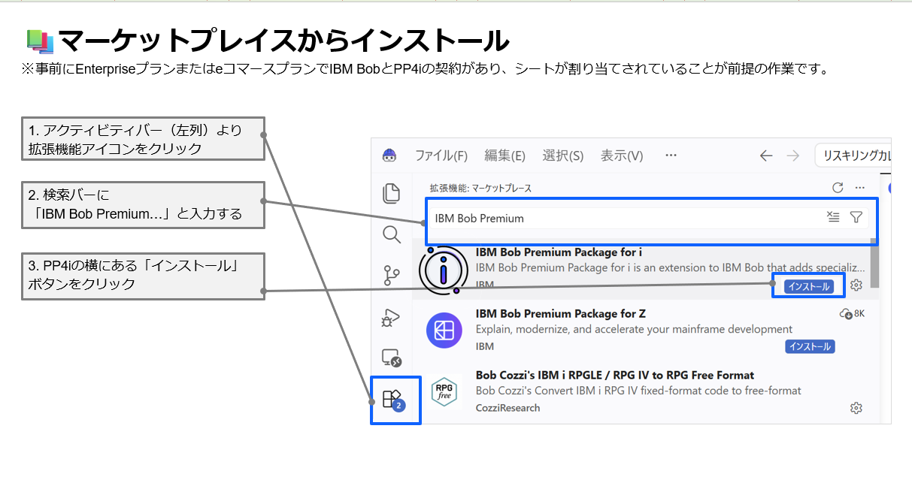
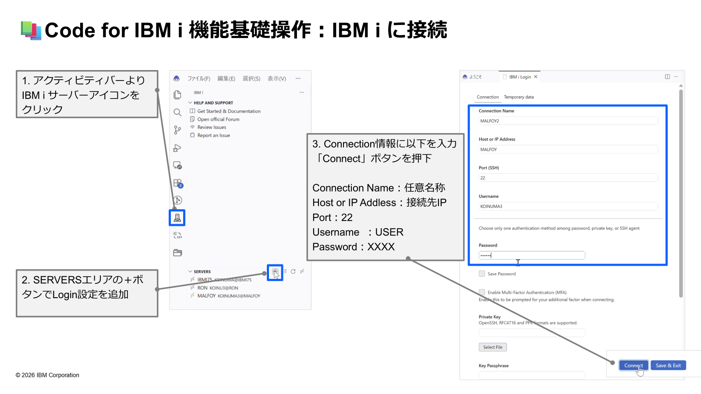
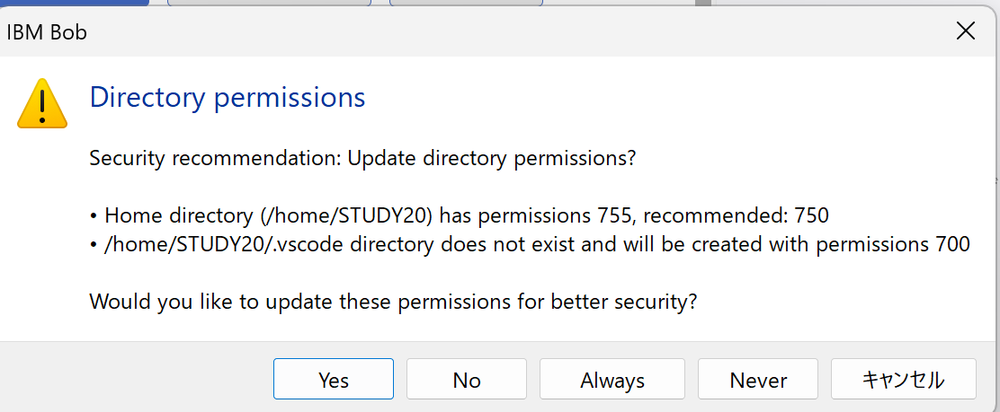
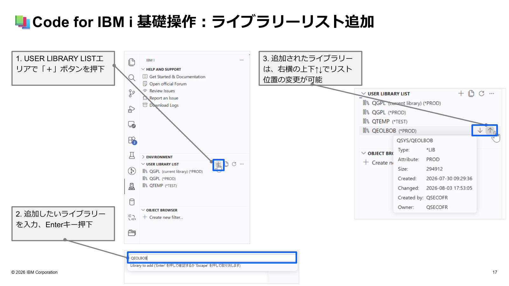
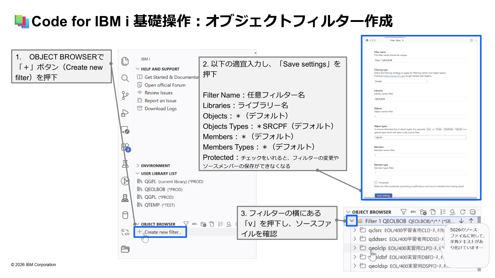
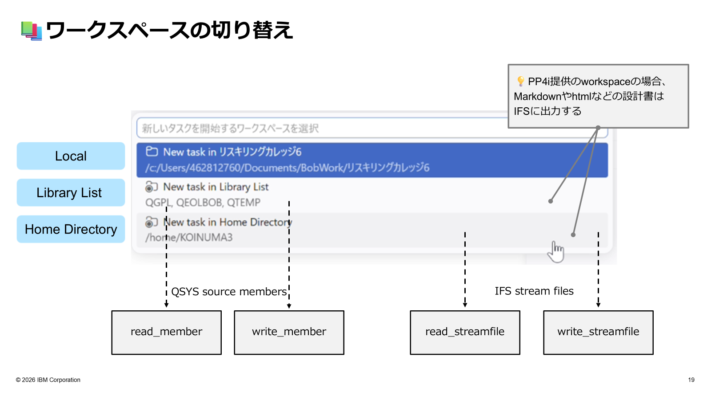
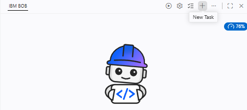
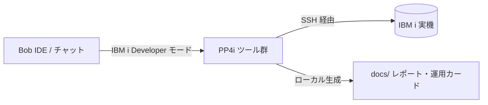

# 00-準備: PP4i のセットアップと IBM i への接続 🔌

## 🎯 この準備の目標

ハンズオンを始める前に、**PP4i のインストール**、**Code for IBM i による IBM i 実機への接続**、**ライブラリーリスト・オブジェクトフィルターの設定**、**Bob のモード（IBM i Developer）とワークスペースの設定**を行います。最後に、Bob が PP4i ツール経由で IBM i の SQL や CL コマンドを実行できることを確認します。

**所要時間**: 15分
**使用モード**: IBM i Developer モード
**ワークスペース**: Local（作業フォルダ：`3_ibmi-hands-on-Operations`）

> ⚠️ **IBM主催ハンズオンの場合**: 作業ライブラリー `STUDYxx` と共通ライブラリー `HANDSON` は講師が用意済みです。自分で作成・複製する必要はありません。

---

## ステップ1: PP4i のインストール（3分）

> 💡 **前提**: IBM Bob の Enterprise プランまたは e コマースプランで、PP4i のシートが割り当てられている必要があります。
>
> ✅ すでに PP4i をインストール済みの場合は、このステップを飛ばしてください。

1. **アクティビティバー**（左端のアイコン群）の **拡張機能アイコン** をクリックします。
2. 検索バーに **`IBM Bob Premium Package for i`** と入力します。
3. PP4i の横にある **「インストール」** ボタンをクリックします。



インストールが完了すると、以下の拡張機能も自動的に追加されます。

| 拡張機能 | 最低バージョン |
|---------|-------------|
| Code for IBM i | 3.0.10 |
| Db2 for IBM i | 2.0.1 |
| RPGLE | 0.33.7 |
| CLLE | 1.2.6 |
| IBM i Testing | 1.3.4 |
| IBMi Languages | 0.6.25 |

💡 **ヒント**: PP4i の前提条件（拡張機能など）は [公式ドキュメント](https://bob.ibm.com/ja/docs/ide/premium-packages/bob-for-i/prerequisites) を参照してください。

---

## ステップ2: ハンズオンフォルダーを開く（1分）

1. Bob IDE のメニューで **「ファイル」→「フォルダーを開く...」**（macOS: **「File」→「Open Folder...」**）を選び、`3_ibmi-hands-on-Operations` フォルダーを開きます。

   > ⚠️ **リポジトリのルート（`ibmi-bob-jp`）ではなく、必ず `3_ibmi-hands-on-Operations` フォルダーそのものを開いてください。** ルートを開くと開発編のルールが読み込まれ、運用編の安全ルール（`ops-safety.md`）が適用されません。

2. エクスプローラーに `LAB1-OPS.md` や `.bob/rules/ops-safety.md` などが表示されていることを確認します。

> 💡 **`.bob/rules/ops-safety.md` について**:
> このフォルダーを開くと、Bob は安全運用ルールを自動的に読み込みます。「参照系は自由・更新系は事前提示と承認必須・システム停止などの危険コマンドは禁止」というガードレールが常に有効になります。

---

## ステップ3: IBM i への接続（3分）

> ⚠️ **IBM主催ハンズオンの場合は、講師から配布された IP アドレス・ユーザー情報を使用してください。**
>
> ⚠️ **IBM i 側の前提条件**（自社環境で実施する場合）:
> - IBM i 7.4 以降
>   - IBM i 7.4 の場合は SF99704 レベル 13 以上
> - SSH デーモンが起動していること（`STRTCPSVR *SSHD`）
> - ライセンス・プログラム `5733-SC1` がインストール済みであること
> - ユーザー `QSSHD` が有効化されていること

1. **アクティビティバー**の **IBM i サーバーアイコン** をクリックします。
2. **SERVERS エリア**の **「＋」ボタン** で接続設定を追加します。
3. 以下の接続情報を入力し、**「Connect」ボタン** を押します。

| 項目 | 入力値（例） | 説明 |
|---|---|---|
| **Connection Name** | `IBMI-HANDSON` | 任意の接続名 |
| **Host or IP Address** | 講師から指定 | IBM i サーバーの IP またはホスト名 |
| **Port** | `22` | SSH ポート番号 |
| **Username** | `STUDYxx`（例：`STUDY01`） | 配布された参加者ユーザープロファイル |
| **Password** | 講師から指定 | パスワード |



4. 接続に成功すると、ステータスバーや IBM i ビューに「Connected」と表示されます。

> 💡 **接続時に「Directory permissions」ダイアログが表示された場合**
> セキュリティ強化のため、ディレクトリーのパーミッションを更新するかを確認するダイアログです。**「Yes」をクリック**してください。
>
> 

---

## ステップ4: ライブラリーリストに `STUDYxx` と `HANDSON` を追加する（2分）

ハンズオンでは、自分の作業ライブラリー `STUDYxx`（例：`STUDY01`）と共通ライブラリー `HANDSON` を使います。この 2 つをライブラリーリストに追加してください。

1. **USER LIBRARY LIST エリア**で **「＋」ボタン** を押します。
2. **`STUDYxx`**（自分の番号）を入力し、**Enter キー** を押します。
3. 同じ手順で **`HANDSON`** も追加します。
4. 追加したライブラリーは、右横の **↑↓ ボタン** でリストの順番を変えられます。



> ⚠️ **追加するライブラリー**: 上のスクリーンショットでは `QEOLBOB` を指定していますが、実際には **`STUDYxx`（自分の番号）と `HANDSON`** を指定してください。

5. USER LIBRARY LIST に次の 2 つが表示されていることを確認します。

   | ライブラリー | 用途 |
   |---|---|
   | `STUDYxx`（例：`STUDY01`） | 自分の作業ライブラリー（QEOL サンプル資産の複製） |
   | `HANDSON` | 参加者共通のライブラリー（模擬業務プログラムなど） |

> 💡 すでに表示されている場合は、追加しなくて大丈夫です。
> ⚠️ `xx` は**自分の番号**に置き換えてください。他の参加者のライブラリーを追加しないよう注意しましょう。

💡 **ヒント**: ライブラリーリストの順番は、プログラムやファイルを探す順番に影響します。

---

## ステップ5: オブジェクトフィルターの作成（2分）

LAB1-OPS で棚卸しする `STUDYxx` のソースを、OBJECT BROWSER から確認できるようにします。

1. **OBJECT BROWSER** で **「＋」ボタン**（Create new filter）を押します。
2. 以下の情報を入力し、**「Save settings」** を押します。

| 項目 | 入力例 | 説明 |
|-----|-------|-----|
| Filter Name | `STUDYxx-SRC` | 任意のフィルター名 |
| Libraries | `STUDYxx` | 対象ライブラリー名（自分の番号） |
| Objects | `*` | すべてのオブジェクト |
| Objects Types | `*SRCPF` | ソース物理ファイル |
| Members | `*` | すべてのメンバー |
| Members Types | `*` | すべてのメンバータイプ |
| Protected | **チェックあり** | 運用編ではソースを変更しないため、誤って編集しないよう保護する |

3. フィルターの横にある **「∨」** を押し、`QEOLRPG` や `QEOLCLP` などのソースファイルを展開して確認します。



> ⚠️ **指定するライブラリー**: 上のスクリーンショットでは `QEOLBOB` でフィルターを作成していますが、実際には **`STUDYxx`（自分の番号）** を指定してください。

---

## ステップ6: Bob のワークスペースとモードを設定する（2分）

PP4i では、次の 3 つのワークスペースを使い分けられます。

| ワークスペース | 対象 | 主な用途 |
|-------------|------|---------|
| **Local** | ローカル PC | 通常の作業・レポートの出力。PP4i ツールで IBM i 上のソースの読み込みや SQL / CL の実行も可能 |
| **Library List** | QSYS ソースメンバー | IBM i 上のライブラリーを指定したソースの直接読み書き |
| **Home Directory** | IFS ストリームファイル | IFS 上のファイル操作 |



> 💡 **運用編では Local ワークスペースを使用します。**
> 実機 IBM i に対して SQL（`execute_sql_statement`）や CL（`execute_cl_command`）、メンバー読み込み（`read_member`）を実行しつつ、生成した稼働レポートや運用ドキュメントをローカルの `docs/` フォルダーに保存するためです。

### 6.1 ワークスペースの選択

1. チャット入力欄の上部にある **New Task**（新しいタスク）をクリックします。

   

2. 一番上にある **「Local」**（PC のワークスペース）を選択します。

### 6.2 モードの選択

1. チャットウィンドウ左下のモード選択から **「IBM i Developer」** を選択します。



---

## ステップ7: 実機への疎通確認（2分）

以下のプロンプトをチャット欄に入力し、Bob に実機情報の取得を依頼します。

```
接続中の IBM i 実機について、以下を SQL で調べて表形式で教えてください。
- システム名
- OS のバージョン・リリース
- 現在のユーザー名
- 現在時刻（CURRENT TIMESTAMP）
```

**期待される動作**:
1. Bob が `execute_sql_statement` ツールを使い、IBM i の環境情報テーブル（`SYSIBMADM.ENV_SYS_INFO` など）から情報を取得する SQL を実行します。
2. 実行結果がチャット上に表形式で表示されます。

> ✅ **確認**:
> 接続先のシステム名や自分のユーザー名（例：`STUDY01`）が表示されれば、実機接続と PP4i ツールの連携は成功です！

> ⚠️ **トラブルシューティング**:
> - **「IBM i に接続されていません」と表示される場合**: Code for IBM i の接続が切れていないか確認し、再接続（Connect）してください。
> - **ツールが呼び出されない場合**: チャットのモードが「IBM i Developer」になっていることを確認してください。
> - **`STUDYxx` のオブジェクトが見つからない場合**: ステップ4でライブラリーリストに自分の `STUDYxx` を追加したか確認してください。

---

## ✅ チェックポイント

- [ ] PP4i がインストールされている
- [ ] `3_ibmi-hands-on-Operations` フォルダーを開いた
- [ ] IBM i に SSH 接続できた
- [ ] ライブラリーリストに `STUDYxx` と `HANDSON` を追加した
- [ ] オブジェクトフィルターで `STUDYxx` のソースファイルを確認できた
- [ ] ワークスペースを **Local**、モードを **IBM i Developer** に設定した
- [ ] 疎通確認のプロンプトで、システム名と自分のユーザー名が表示された

---

## 💡 このハンズオンでの約束ごと

| 項目 | 内容 |
|-----|------|
| `xx` | プロンプト中の `xx` は**自分の番号**に置き換えてください（例：`STUDYxx` → `STUDY01`、`OPSxxA` → `OPS01A`） |
| 承認ボタン | Bob が承認を求めてきたら、**実行される SQL / コマンドを読んでから**承認してください。運用で最も大切なポイントです。更新系の操作は **「Always allow」を選ばず**、毎回内容を確認しましょう |
| 出力先 | Bob が作るレポートは `docs/` フォルダーに保存させます |
| 答え合わせ | Bob が作った SQL は `sql/` フォルダーの参考 SQL と見比べられます（一致している必要はありません） |

---

**次のページ**: [LAB1-OPS: 資産の見える化](./LAB1-OPS.md)
