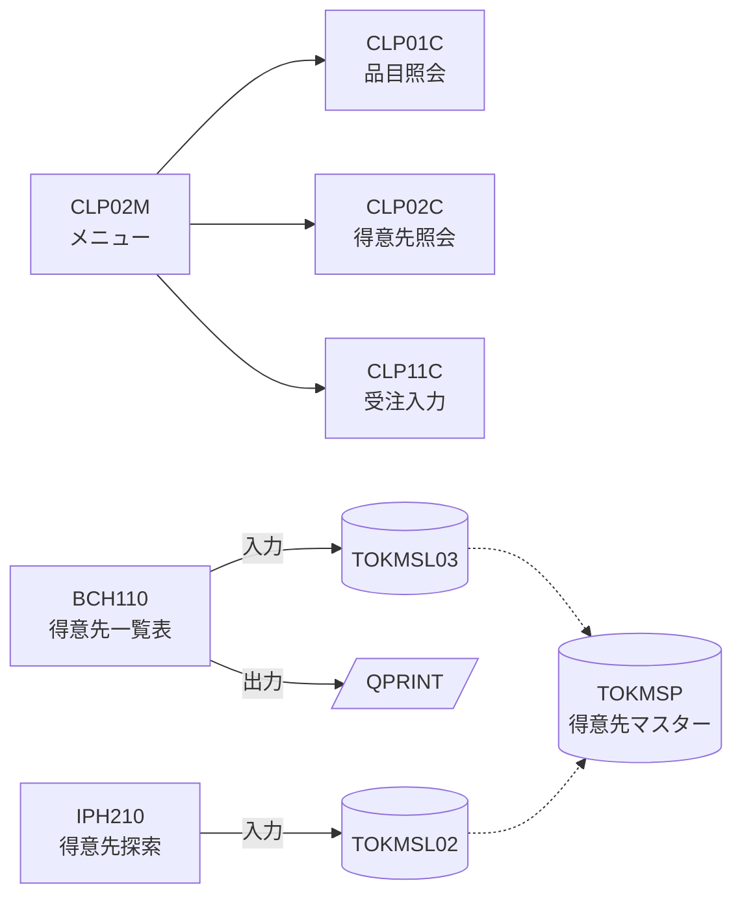

# LAB1-OPS: 資産の見える化 📦

## 🎯 このラボの目標

運用・保守担当者が日常的に直面する **「このライブラリーに何があるのか分からない」「夜間にこのプログラムが落ちたら何が困るのか、再実行して安全なのか分からない」** という課題を、PP4i に接続した Bob で解決します。

IBM i 実機のオブジェクト棚卸し → 最終使用日による休眠資産の洗い出し → プログラム間・ファイル間の関係図（Mermaid） → **夜間障害時に運用者が最初に読む「プログラム説明カード」** の作成までを体験します。

**所要時間**: 15分
**難易度**: ★★☆☆☆（初中級）
**使用モード**: IBM i Developer モード
**ワークスペース**: Local

---

## 📚 学習内容

- ✅ IBM i Services（`QSYS2.OBJECT_STATISTICS`、`QSYS2.SYSPARTITIONSTAT`）による実機資産の高速棚卸し
- ✅ 最終使用日（`LAST_USED_TIMESTAMP`）を使った休眠資産の抽出
- ✅ プログラム⇔ファイル相互参照（`DSPPGMREF` またはソース解析）と Mermaid 視覚化
- ✅ `read_member` によるソース読み込みと運用者向け「プログラム説明カード」の生成

---

## ステップ1: 実機オブジェクトの棚卸し（3分）

まずは作業ライブラリーに「何が存在するのか」を調べます。以下のプロンプトをチャット欄に入力してください（`xx` は自分の番号、例：`STUDY01`）：

```
接続先 IBM i の STUDYxx ライブラリーにあるオブジェクトを棚卸ししてください。
- オブジェクトの種類（*PGM、*FILE、*SRVPGM、*MODULE など）ごとの件数
- プログラムとファイルの一覧（オブジェクト名・タイプ・属性・テキスト説明・作成日・最終使用日・使用日数）
結果は表形式でまとめてください。
```

**期待される動作**:
1. Bob が PP4i ツール `execute_sql_statement` を呼び出し、`QSYS2.OBJECT_STATISTICS` を使ったクエリを実行します。
2. オブジェクトの種類別集計と詳細一覧がチャットに表示されます。

> 💡 **運用者視点のポイント**: 従来 5250 画面の `WRKOBJ` や `DSPOBJD` で 1 つずつ確認していた情報が、IBM i Services により「最終使用日」「使用日数」付きで一括取得できます。

### 1.1 ソースメンバーの棚卸し

```
STUDYxx ライブラリーのソースファイルにあるメンバーを、
ソースファイル別・ソースタイプ別（RPG、RPGLE、CLLE、DSPF、PF、LF など）に件数を集計してください。
最終更新日が新しい順に上位10件も表示してください。
```

> 💡 Bob は `QSYS2.SYSPARTITIONSTAT` を使うはずです。参考 SQL は [`sql/01_資産の見える化.sql`](./sql/01_資産の見える化.sql) にあります。

---

## ステップ2: 使われていない資産を洗い出す（3分）

```
ステップ1 の結果から、次の観点で「整理候補」を洗い出してください。
- 一度も使用されていないプログラム／ファイル
- 最終使用日が 1 年以上前のもの
- オブジェクトはあるがソースが見つからないプログラム、またはその逆

判断根拠も1行ずつ添えてください。削除などの操作は不要です。
```

**期待される回答のポイント**:
- 最終使用日（`LAST_USED_TIMESTAMP`）が NULL のオブジェクト
- ソースメンバーとオブジェクトの突合せ結果
- 「削除してよいかは業務部門に確認が必要」といった注意喚起

> ⚠️ **注意**: QEOL はサンプルライブラリーのため、ほとんどのオブジェクトが「未使用」と判定される可能性があります。実際のお客様環境では、ここで**棚卸し・移行対象の絞り込み**に大きな効果があります。

---

## ステップ3: プログラムとファイルの関係を図にする（4分）

障害時に「このファイルが壊れたら、どのプログラムが影響を受ける？」にすぐ答えられるよう、関係図を作ります。

```
STUDYxx ライブラリーのプログラムについて、
どのプログラムがどのファイルを使い、どのプログラムを呼び出しているかを調べてください。

- プログラムオブジェクトがある場合は DSPPGMREF を OUTPUT(*OUTFILE) で
  STUDYxx/PGMREF に出力して集計してください。
- プログラムオブジェクトがない場合は、QEOLRPG と QEOLCLP のソースを read_member で読み、
  F仕様書・CALL 文・DCLF から関係を抽出してください。

結果は次の2つで示してください。
1. 相互参照表（プログラム／使用ファイル／入出力区分／呼び出し先）
2. Mermaid のフローチャート（プログラム → ファイル、プログラム → プログラム）
```

**期待される出力（例・一部）**:



> 💡 **ポイント**: 論理ファイル（LF）→ 物理ファイル（PF）の関係まで追ってくれると、「TOKMSP（得意先マスター）が壊れたら BCH110 と IPH210 が影響を受ける」という**影響範囲**がひと目で分かります。追ってくれない場合は「論理ファイルの基になる物理ファイルも辿ってください」と追加で指示してみましょう。

---

## ステップ4: 運用者向け「プログラム説明カード」を作る（5分）

開発者向けの設計書ではなく、**夜間に障害連絡を受けた運用担当者が最初に読む1枚のカード**を作ります。

```
STUDYxx/QEOLRPG のメンバー bch110 を read_member で実機から直接読み込み、
運用担当者向けの「プログラム説明カード」を Markdown で作成して
docs/bch110_運用カード.md に保存してください。
RPG の仕様やファイル使用法は RAG 等で正確に確認した上で記述してください。

【記載項目】
1. このプログラムの役割（業務担当者にも分かる言葉で 3 行以内）
2. 入力ファイル／出力（帳票・出力ファイル）
3. 異常終了時の業務影響
4. 再実行可否（二重実行で問題が起きるか）とその技術的根拠（F仕様書のファイル指定など）
5. 再実行前に確認すべき前提条件
6. 関連プログラム・関連ファイル（ステップ3 の相互参照情報）
7. 開発担当者へのエスカレーション時に伝えるべき情報
```

**期待される動作**:
1. Bob が PP4i ツール `read_member` を使用して、接続先 IBM i の `STUDYxx/QEOLRPG/bch110.rpgle`（または `.rpg`）のソースコードを読み込みます。
2. F仕様書（ファイルのオープンモード: `IF`=入力専用、`UF`=更新、`O`=出力など）を解析し、プログラムの動作と再実行リスクを判断します。
3. `write_file` でローカルの `docs/bch110_運用カード.md` に保存します。

**期待される内容（例）**:

| 項目 | 内容例 |
|---|---|
| **役割** | 得意先マスターを得意先番号順に全件読み込み、一覧表帳票を印刷する |
| **入力／出力** | 入力：`TOKMSL03`（得意先マスター論理ファイル）／ 出力：`QPRINT`（プリンターファイル） |
| **業務影響** | 得意先一覧表が出力されない。データベースの更新は行わないためデータ破壊はない |
| **再実行可否** | **【再実行可】** 参照のみ（F仕様書が `IF` ＝ Input Full）のため、再実行しても帳票が再出力されるだけでデータベースの二重更新は発生しない |
| **確認事項** | 出力待ち行列（OUTQ）に破損したスプールが残っていないか確認 |

💡 **確認方法**: VS Code / Bob IDE のエクスプローラーから `docs/bch110_運用カード.md` を開き、右上のプレビューアイコンをクリックして確認します。

> 💡 **なぜ「再実行可否」が運用で重要か**:
> 障害発生時に運用担当者が最も判断に迷うのが「もう一度ジョブを投入してよいか（二重更新事故にならないか）」です。Bob はソースコードのファイル仕様や更新ロジックを読み解き、安全に再実行できるかの根拠を提示できます。

---

## ✅ チェックポイント

- [ ] `STUDYxx` のオブジェクトを種類別に集計できた
- [ ] 最終使用日をもとに整理候補を洗い出せた
- [ ] プログラム⇔ファイル⇔プログラムの関係を表と Mermaid 図で出せた
- [ ] `docs/bch110_運用カード.md` が作成され、「再実行してよいか」に根拠付きで答えている

---

## 💡 このラボで学んだこと

✅ **SQL を書かずに資産を棚卸しできる**
- `OBJECT_STATISTICS`・`SYSPARTITIONSTAT` を Bob が組み立てて実行
- 最終使用日から整理候補を抽出

✅ **影響範囲がすぐ分かる**
- オブジェクト参照（`DSPPGMREF`）またはソース解析から相互参照を作成
- LF → PF まで辿ることで「このファイルが壊れたら何が止まるか」が分かる

✅ **運用者のためのドキュメントが作れる**
- 開発者向け仕様書ではなく「再実行してよいか」「誰に何を伝えるか」に答えるカード
- お客様環境では、**夜間バッチの主要プログラムすべて**についてカードを作っておくと、障害対応の初動が大きく変わります

---

**前のページ**: [00-準備](./00-準備.md) | **次のページ**: [LAB2-OPS: ジョブ／サブシステムの見える化](./LAB2-OPS.md)
