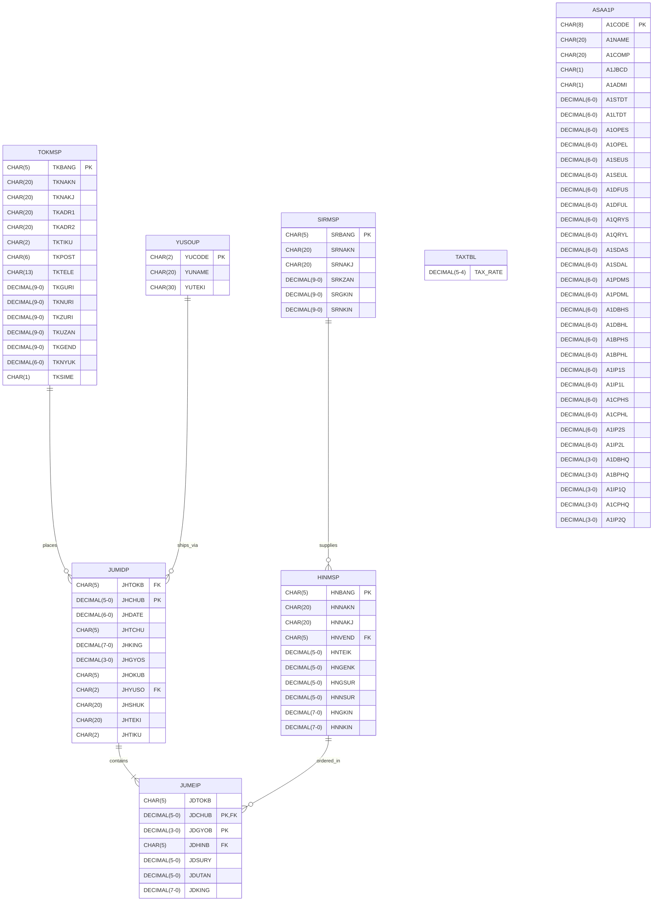

# LAB2-PP4i: PP4i 開発系オプションメニュー（ワークフロー・スラッシュコマンド） ⚙️

## 🎯 このラボの目標

このラボは**PP4i開発系オプションメニュー**です。PP4iが提供する**ワークフロー**や**/(スラッシュ)コマンド**を実際に動かして、IBM i 開発における様々な作業の自動化を体験します。

すべての項目は**選択式のオプション**となっています。ご自身の興味や業務ニーズに合わせて、気になるメニューを選んで実施してください（もちろん複数実施しても構いません）。

**所要時間**: 選択したメニューあたり 約5〜15分
**難易度**: ★★★☆☆（中級）
**使用モード**: IBM i Developer モード
**ワークスペース**: Library List（または IFS ※メニューによる）

---

## 📚 学習内容・メニュー選択

以下のメニューから、試してみたい項目をクリックすると詳細手順にジャンプします：

### 🛠️ 共通事前準備
- ⚙️ [共通事前準備: ワークスペースとモードの確認](#共通事前準備-ワークスペースとモードの確認)

---

### 📋 選択メニュー一覧

#### 1. ワークフロー（複雑な開発プロセスの自動化）
- 📄 [【選択肢A】Business Rules 抽出ワークフロー（所要時間: 約8分）](#選択肢a-business-rules-抽出ワークフローを実行)
  *既存RPGプログラムから計算ルールや条件分岐などのビジネスルールを自動解析・ドキュメント化します。*

#### 2. スラッシュコマンド（クイック実行コマンド）
- 📐🔍 [【選択肢B】スラッシュコマンド（`/erd`・`/review_SQL`）の体験（所要時間: 約8分）](#選択肢b-スラッシュコマンドerdreview_sqlを体験)
  *`/erd` でデータベースのER図を自動生成し、`/review_SQL` でSQLのパフォーマンスやベストプラクティスを診断します。*
- 🔬 [【選択肢C】`/review_RPG` でレビューして改修する（所要時間: 約10-15分）](#選択肢c-review_rpg-でレビューして改修する)
  *RPGソースを自動レビューし、指摘をもとにBobと対話してコードを改修・実行確認します。*

---

## ⚙️ 共通事前準備: ワークスペースとモードの確認

どのメニューを実施する場合でも、まずは以下の環境準備を行ってください。

### 1. ワークスペースを Library List に切り替える

このラボでは IBM i 上のソースを直接操作するため、ワークスペースを **Library List** に切り替えます。

1. チャット入力欄の上部にある **New Task** をクリック
2. **「Library List」** を選択
3. LAB1-PP4i で追加した `STUDYxx` ライブラリーが含まれていることを確認

> 💡 **LAB1-PP4iとの違い**: LAB1-PP4iではLocalワークスペースでHTMLを生成しました。このラボではIBM i 上のソースメンバーを直接読み書きするため Library List を使用します。

### 2. IBM i Developer モードを選択

1. **チャットウィンドウ左下**のモード選択から **「IBM i Developer」** モードを選択

---

## 📄 【選択肢A】Business Rules 抽出ワークフローを実行

PP4iのワークフローを使って、既存RPGプログラムからビジネスルールを自動抽出します。

> 💡 **ワークフローとは？**  
> 複数のスキル・ツールを組み合わせて複雑なタスクを**手順通りに自動実行**するPP4i固有の機能です。「手順書を自動で実行してくれる仕組み」とイメージしてください。

### 2.1 ワークフローの起動


1. チャット画面の **「Start Workflow」** ボタンを押下

2. ワークフローを実行する**ワークスペースを指定**し、**Enter キー** を押下  
   - 今回は **Library List** を指定

3. 表示されるワークフロー一覧から **「Business Rules 抽出」** の開始ボタン（▶）を押下

### 2.2 抽出対象の指定

Bobから対象プログラムを聞かれたら以下を指定してください。
（他のソースメンバーを選んでいただいてもOKです）

```
STUDYxx/QEOLRPG の bch110 メンバー
```

### 2.3 抽出結果の確認

**期待される動作**:
1. `read_member` ツールが `bch110` を IBM i から直接取得
2. ビジネスルール（計算式・条件分岐・処理フロー）を自動解析
3. Markdown形式のドキュメントを生成・表示

**期待される回答のポイント**:
- 計算ルール（例：利用可能額 = 信用限度額 − 売掛金残高）
- ループ・条件分岐のロジック
- 入出力ファイルの役割
- エラー処理の有無

---

## 📐🔍 【選択肢B】スラッシュコマンド（`/erd`・`/review_SQL`）を体験

スラッシュコマンドを使って、データベースの可視化とSQLレビューを体験します。

> 💡 **スラッシュコマンドとは？**
> ワークフローほど複雑ではないが、よく使う作業をコマンド化したPP4i固有の機能です。`/` を入力するとコマンド一覧が表示されます。

---

### パート1: `/erd` コマンドでERD（実体関連図）を生成（5分）

接続中のIBM i データベースの構造からER図を自動生成します。

#### 1. /erdコマンドの実行

1. チャット入力欄で **`/erd`** と入力
2. コマンド一覧から `erd` を選択
3. 対象ライブラリー名を入力：

```
STUDYxx
```

**期待される出力（Mermaid ERD）**:



💡 **活用シーン**: 引き継ぎ資料・設計書にそのまま貼り付けて使えます。ドキュメント不足のシステムでも即座にDB全体像を把握できます。

---

### パート2: `/review_SQL` コマンドでSQLをレビュー（3分）

#### 1. /review_SQLコマンドの実行

1. チャット入力欄で **`/review_SQL`** と入力
2. コマンド一覧から `review_SQL` を選択
3. 続けて以下のSQLを貼り付けて送信：

```sql
SELECT TKBANG, TKNAKJ, TKGEND, TKUZAN, (TKGEND - TKUZAN) AS RIYO
FROM STUDYxx/TOKMSP
WHERE TKUZAN > 0
ORDER BY TKUZAN DESC
```

**期待される回答のポイント**（事前定義のチェックリストに基づく）:
- ✅ **正確性**: SQLが意図した結果を返すか
- ✅ **パフォーマンス**: インデックスの活用・実行計画
- ✅ **セキュリティ**: リスクの有無
- ✅ **ベストプラクティス**: Db2 for i の推奨事項への準拠（`STUDYxx/TOKMSP` → `STUDYxx.TOKMSP` 形式など）

---

## 🔬 【選択肢C】`/review_RPG` でレビューして改修する

> ⏱️ **時間に余裕がある方向け**。このオプションは**他のステップ・他のラボの成果物に依存しません**。IBM i に接続済み（IBM i Developer モード）であれば、単独で実施できます。

レビュー用のサンプルRPGソースをBobに作らせ、`/review_RPG` でレビュー → 指摘をもとに改修 → コンパイル・実行まで、**レビューから改修までの流れ**を一通り体験します。

| 手順 | 内容 | 目安 |
|-----|------|-----|
| A | サンプルRPGソースの準備 | 2分 |
| B | `/review_RPG` でレビュー | 3分 |
| C | 指摘に基づく改修 | 3分 |
| D | コンパイル・実行して確認 | 3-5分 |

### 手順A: サンプルRPGソースの準備（2分）

IBM i の IFS（統合ファイルシステム）上に、レビュー対象のRPGソースをBobに作成させます。以下をそのままBobに送信してください。

```
IFS のホームディレクトリー配下に review_demo ディレクトリーを作成し、
その中に REVDEMO.rpgle というファイル名で、以下のRPGソースをそのまま作成してください。
（内容は修正せず、そのまま書き込んでください）

**free
ctl-opt dftactgrp(*no);

dcl-s i int(10);
dcl-s qty packed(5:0) dim(3);
dcl-s amt packed(9:2) dim(3);
dcl-s a packed(9:2);
dcl-s unusedwk char(10);
dcl-s msg char(52);

qty(1) = 10; amt(1) = 15000.00;
qty(2) = 5;  amt(2) = 8000.00;
qty(3) = 0;  amt(3) = 3000.00;

for i = 1 to 3;
  a = amt(i) - (amt(i) * 0.05);
  msg = 'No' + %char(i) + ' unit=' + %char(a / qty(i));
  dsply msg;
endfor;

*inlr = *on;
return;
```

> 💡 **このサンプルについて**: 3件の金額から5%割引後の単価（割引後金額 ÷ 数量）を表示する小さなプログラムです。データベースやライブラリー内のソースは使いません。数量が 0 の明細（3件目）、5% の直書き、未使用変数など、**レビューで指摘されやすいポイントを意図的に含めています**。

**期待される動作**: `write_stream_file` ツールで `REVDEMO.rpgle` が作成され、作成先のパスがBobから報告されます。**このパスを控えてください**（次の手順で使います）。

### 手順B: /review_RPG でレビュー（3分）

1. チャット入力欄で **`/review_RPG`** と入力
2. コマンド一覧から `review_RPG` を選択
3. 続けて、手順Aで控えたIFSパスを指定して送信（例：`/home/ユーザー名/review_demo/REVDEMO.rpgle`）

**期待される回答のポイント**:

`/review_RPG` は、RPGソース（`.RPGLE` など）の構文・コーディング標準・エラー処理・セキュリティ・パフォーマンス・モダナイゼーションの観点でレビューし、次の構成で結果を返します。

| 項目 | 内容 |
|-----|------|
| Detected Format | ソースの形式（固定形式／フリー形式／混在） |
| Summary | レビュー全体の要約 |
| Critical Issues | 重大な構文・セキュリティ・実行時の不具合 |
| Major Issues | 構造上の問題・性能・未処理のエラー |
| Minor Issues | スタイルの不統一・軽微な整理 |
| Modernization Roadmap | モダナイズの進め方 |

今回のサンプルでは、例えば次のような指摘が出ることが期待されます。

- 数量が 0 の場合の**ゼロ除算に対するエラー処理（`MONITOR`）がない**
- 割引率 `0.05` が**直書き（マジックナンバー）**になっている
- **未使用の変数**（`unusedwk`）や、意味の分かりにくい変数名（`a`）がある

> ⚠️ **注意**: 指摘の内容・件数はレビューを実行するたびに多少異なる場合があります。上記と完全に一致しなくても問題ありません。なお、`/review_RPG` は RPG 以外のソース（CL・COBOL・DDS・SQL のみ等）を対象にすると、レビュー前に拒否されます。

### 手順C: 指摘に基づく改修（3分）

指摘の中から、**安全に直せるものを1〜2点**選び、通常のチャットでBobに改修を依頼します。元のソースは残し、**別名のファイルに改修版を書き込む**ようにして、前後を比較できるようにします。

```
レビュー指摘のうち、以下の2点を反映した改修版を、同じディレクトリーに
REVDEMO2.rpgle という名前で作成してください。元の REVDEMO.rpgle は変更しないでください。
- ゼロ除算に対するエラー処理（数量が 0 の場合は「数量が0のため計算不可」と表示して次の明細へ進む）
- 割引率 0.05 の定数化と、変数名 a の分かりやすい名前への変更
```

**期待される動作**:
1. Bobが指摘内容を踏まえてソースを修正
2. `write_stream_file` ツールで `REVDEMO2.rpgle` が作成される
3. 変更点の説明がチャットに表示される

> 💡 **ポイント**: 指摘のうち、どれを直すかは自分で選べます。Critical / Major の指摘から選ぶのがおすすめです。

### 手順D: コンパイル・実行して確認（3-5分）

改修前後のソースをコンパイル・実行して、挙動を比較します。Bobに次のように依頼してください。

```
REVDEMO.rpgle と REVDEMO2.rpgle を、それぞれ自分が書き込めるライブラリーに
プログラム REVDEMO と REVDEMO2 としてコンパイルし、REVDEMO2 を実行して結果を報告してください。
```

**期待される動作**:
1. Bobがコンパイルコマンド（`CRTBNDRPG` など）を実行し、結果を報告
2. `REVDEMO2` を実行し、3件分の表示結果をチャットに報告
3. 改修前の `REVDEMO` は、3件目（数量 0）でゼロ除算エラーとなる可能性がある（実行して比較する場合）

> 💡 **ポイント**: コンパイルエラーが出た場合も、そのままBobに「修正してください」と伝えるだけで対応できます。`DSPLY` の出力がチャットで確認しにくい場合は、5250画面で `CALL` コマンドを実行して確認してください。

---

## ✅ チェックポイント

実施したメニューに応じて、以下を確認してください：

- [ ] ワークスペースを Library List に切り替えられた
- [ ] ワークフローまたはスラッシュコマンドから、関心のある機能を選択して実行できた
- [ ] ワークフローとスラッシュコマンドの使い分けのイメージが持てた
- [ ] 🔬 （オプション）レビュー指摘を反映した改修版をコンパイル・実行できた

---

## 💡 このラボで学んだこと

### PP4iワークフロー・スラッシュコマンドでできたこと

✅ **複雑な作業を手順通りに自動化（ワークフロー）**
- 従来: 手動でソースを読み解き、ビジネスルールを一つひとつ文書化（数時間〜数日）
- PP4i活用: ワークフローを起動するだけでビジネスルール抽出を自動実行（数分）

✅ **よく使う作業をコマンド1つで実行（スラッシュコマンド）**
- `/erd` でDB全体のER図を即生成
- `/review_SQL` でSQLを包括的にレビュー
- 🔬 （オプション）`/review_RPG` でRPGソースをレビューし、指摘から改修まで実施

### ワークフローとスラッシュコマンドの使い分け

| | ワークフロー | スラッシュコマンド |
|--|------------|----------------|
| 複雑さ | 多段階・複雑なタスク | 比較的シンプルなタスク |
| 起動方法 | Start Workflow ボタン | `/` から入力 |
| 例 | Business Rules抽出 | /erd、/review_SQL |
| 対話 | Bobと対話しながら進む | 入力後すぐ結果が返る |

### PP4i全機能マップ（おさらい）

```
PP4i
├── スキル（自動適用） ← LAB1-PP4iで体験
│   └── RPG/DDS/CL/SQLの専門知識で精度向上
├── ツール（明示的に呼び出し可能） ← LAB1-PP4iで体験
│   └── read_member / write_member / execute_cl_command 等
├── RAG（IBM i 公式ドキュメント参照） ← LAB1-PP4iで体験
├── ワークフロー（Start Workflowから起動） ← このラボで体験
│   └── Business Rules 抽出
└── /(スラッシュ)コマンド ← このラボで体験
    ├── /erd -> ERD生成
    ├── /review_SQL -> SQLレビュー
    └── /review_RPG -> RPGレビュー（オプション）
```

### 実務での活用シーン

1. **引き継ぎ・ドキュメント整備**
   - Business Rules 抽出で既存システムを即座にドキュメント化
   - `/erd` で複雑なDB設計を可視化して後任者に引き継ぎ

2. **SQL品質向上**
   - `/review_SQL` でパフォーマンス問題を事前発見
   - Db2 for i のベストプラクティスへの準拠を確認

---

## 🎯 よくある質問

**Q: ワークフローの結果はどこに保存される？**

A: Library List ワークスペースの場合、書き込みは `write_member` ツールを通じてQSYSソースメンバーに直接行われます。

**Q: /erdで特定のテーブルだけ表示できる？**

A: `/erd` 実行後、Bobにテーブルを絞り込むよう指示することができます（例：「TOKMSPとJUMEIPのみのERDを生成してください」）。

---

## 🎉 ラボ完了！

お疲れ様でした！PP4iのワークフローとスラッシュコマンドを使った自動化を体験しました。

### このワークショップで学んだこと（まとめ）

| ラボ | 内容 | 習得スキル |
|-----|------|----------|
| LAB1-PP4i（基本） | PP4i基本操作 | IBM i 接続、スキル/ツール/RAG、HTML設計書生成 |
| **LAB2-PP4i（開発系オプション）** | **ワークフロー・スラッシュコマンド** | **Business Rules抽出、ERD生成、SQLレビュー、RPGレビュー・改修** |
| LAB3-PP4i（運用系オプション） | 資産の見える化 | IBM i Services SQL・相互参照分析・運用カード生成 |

### 次のステップ

- 準備ができたら、次のラボに進みましょう：
- 👉 **[LAB3-PP4i: PP4i 運用系オプション（資産の見える化）](./LAB3-PP4i.md)** - 運用担当者視点でライブラリーの棚卸し・休眠資産の洗い出し・運用カード作成を体験します

---

**前のページ**: [LAB1-PP4i](./LAB1-PP4i.md) | **次のページ**: [LAB3-PP4i](./LAB3-PP4i.md)
